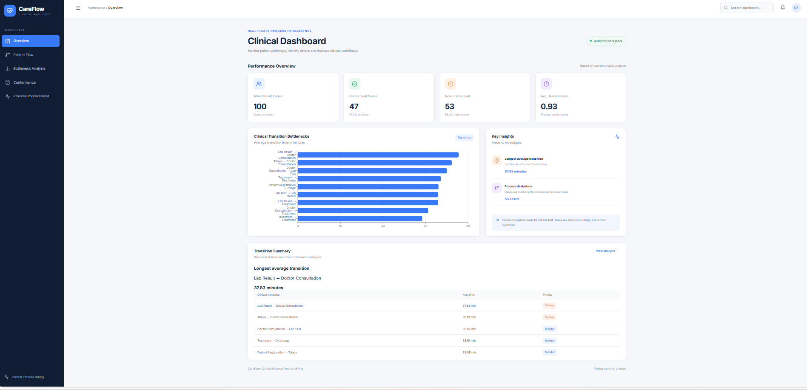
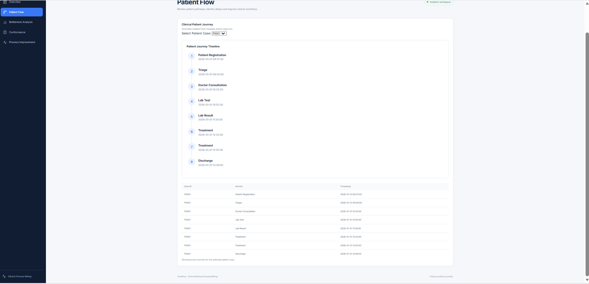
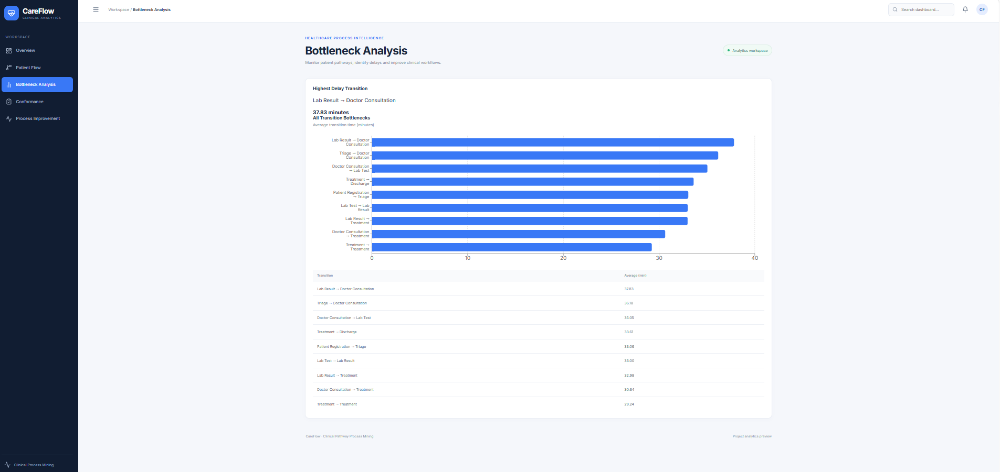
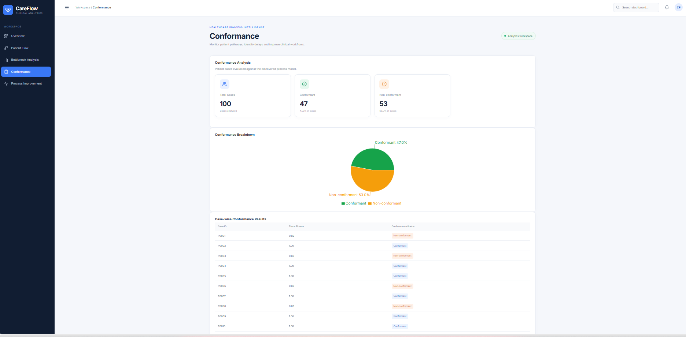
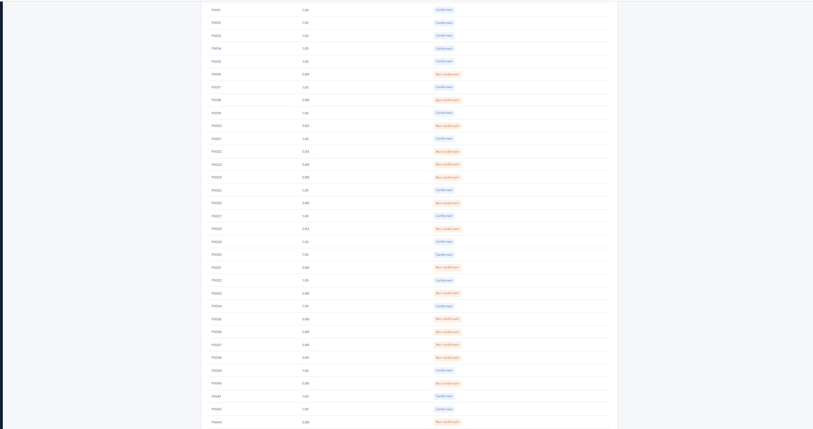
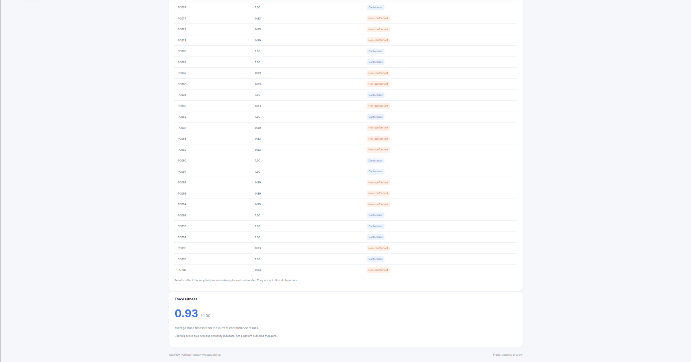
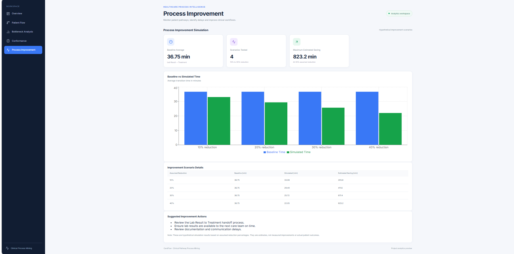

# CareFlow: Clinical Pathway Process Mining

**Infotact Group Project**

## 1. Project Overview

CareFlow is a healthcare process analytics project that uses Process Mining to analyze simulated hospital event logs. It identifies patient journey patterns, process bottlenecks, repeated activities, and deviations from an expected clinical pathway.

The project also simulates hypothetical process improvement scenarios to estimate how reducing elapsed time between activities could affect overall transition time.

## 2. Problem Statement

Average hospital journey times alone may not reveal which activities or transitions contribute to delays or why patient pathways differ. CareFlow analyzes event-level data to identify these patterns and support evidence-based investigation of potential process improvements.

## 3. Objectives

- Validate hospital event log quality.
- Discover the hospital process model using PM4Py.
- Identify transitions with high elapsed times.
- Analyze repeated activities and loop-back patterns.
- Compare observed pathways with an expected pathway.
- Group patients by process variants.
- Simulate hypothetical process improvement scenarios.
- Generate CSV reports for further analysis.
- Visualize process analytics through an interactive dashboard.

## 4. Technologies Used

- Python
- Pandas
- PM4Py
- CSV-based event logs
- Python `unittest`
- dbt
- Google BigQuery
- React
- Vite
- JavaScript
- Recharts
- PapaParse
- Lucide React

## 5. Project Modules

| Module | Purpose |
|---|---|
| `validate_event_log.py` | Checks event log quality |
| `process_mining.py` | Discovers and exports a process tree |
| `bottleneck_analysis.py` | Calculates elapsed-time statistics for activity transitions |
| `loopback_analysis.py` | Identifies repeated or backward activity transitions |
| `conformance_checking.py` | Compares observed pathways with an expected pathway |
| `deviation_summary.py` | Summarizes pathway deviations |
| `process_variants.py` | Identifies unique patient journey patterns |
| `process_improvement_simulation.py` | Estimates hypothetical improvement scenarios |
| `test_process_improvement.py` | Runs automated tests for the simulation |
| `mock_data.py` | Supports mock event data generation |

## 6. Event Log

The current simulated dataset contains 723 events for 100 patients. The event log includes:

- Case ID
- Activity Name
- Timestamp

The expected clinical pathway is:

Patient Registration → Triage → Doctor Consultation → Lab Test → Lab Result → Treatment → Discharge

## 7. Setup

### Backend Setup

Create and activate a Python virtual environment, then install the required dependencies.

```bash
python -m venv venv
venv\Scripts\activate
pip install pandas pm4py
```

Additional dependencies may be required for the dbt/BigQuery workflow. Configure Google Cloud authentication and the dbt profile separately before running that workflow.

### Frontend Setup

Navigate to the frontend directory and install the required packages.

```bash
cd frontend
npm install
```

## 8. Running the Analysis

Run these commands from the project root directory:

```bash
python validate_event_log.py
python process_mining.py
python bottleneck_analysis.py
python loopback_analysis.py
python conformance_checking.py
python deviation_summary.py
python process_variants.py
python process_improvement_simulation.py
```

### Running Automated Tests

```bash
python -m unittest test_process_improvement.py -v
```

## 9. Current Results

- 100 simulated patient journeys.
- 723 total events.
- 47 patients followed the expected pathway.
- 53 patients were classified as deviating from the expected pathway.
- Five distinct process variants were identified.
- The Lab Result → Treatment transition had a mean recorded elapsed time of 36.75 minutes across 56 transitions.
- Seven automated process-improvement simulation tests passed.

## 10. Output Reports

The project generates CSV reports for:

- Event log validation
- Bottleneck analysis
- Loop-back analysis
- Conformance checking
- Deviation summaries
- Process variants
- Process improvement scenarios

The process mining module also generates a process tree image (`process_tree.png`).

## 11. Interactive Dashboard

CareFlow includes an interactive dashboard developed using React and Vite. It provides visual analysis of patient journeys, bottlenecks, conformance, and process improvement scenarios.

### Dashboard Pages

1. **Overview:** Displays key project metrics and clinical transition bottlenecks.
2. **Patient Flow:** Visualizes the activity timeline of individual patients.
3. **Bottleneck Analysis:** Identifies time-consuming transitions in the clinical pathway.
4. **Conformance:** Compares conformant and non-conformant patient cases.
5. **Process Improvement:** Compares baseline transition time with hypothetical improvement scenarios.

### Dashboard Screenshots

#### 1. Overview



#### 2. Patient Flow



#### 3. Bottleneck Analysis



#### 4. Conformance Analysis








#### 5. Process Improvement



### Run the Dashboard

From the project root directory:

```bash
cd frontend
npm install
npm run dev
```

Open the local URL displayed in the terminal to access the dashboard.

## 12. Limitations

- **Simulated Dataset:** The project uses simulated hospital event logs instead of real patient records.
- **Limited Dataset Size:** The current analysis is based on 100 patient cases and 723 events.
- **No Real-Time Monitoring:** The system does not process live hospital activities.
- **Hypothetical Improvement:** Process improvement results are simulated estimates, not actual measured reductions.
- **Predefined Clinical Pathway:** The conformance analysis uses a predefined expected clinical pathway.

## 13. Future Scope

- **Real Hospital Data Integration:** Integrate real Electronic Health Record (EHR) data for practical analysis.
- **Real-Time Monitoring:** Monitor hospital activities and identify process delays in real time.
- **AI-Based Prediction:** Use machine learning to predict bottlenecks and potential patient journey delays.
- **Advanced Process Mining:** Support multiple clinical pathways and complex hospital workflows.
- **Automated Alerts:** Generate alerts when unusual delays or process deviations occur.
- **Enhanced Testing:** Add more automated tests to improve system reliability.

## 14. Conclusion

CareFlow demonstrates how Process Mining can be used to analyze hospital workflows, identify bottlenecks, understand patient journey deviations, and explore possible process improvements. The interactive dashboard makes these analytical results easier to understand and interpret.

The project provides a foundation for future healthcare process optimization using real-world data and advanced analytics.