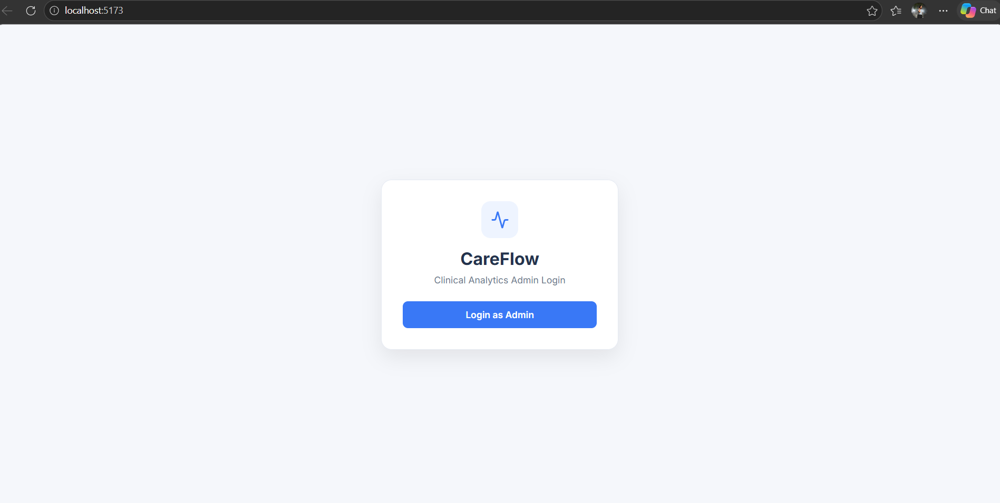
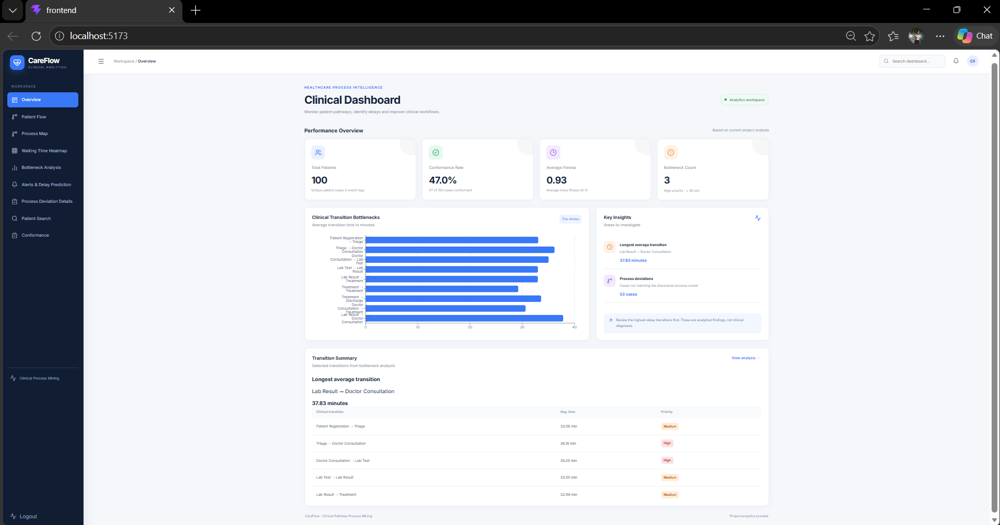
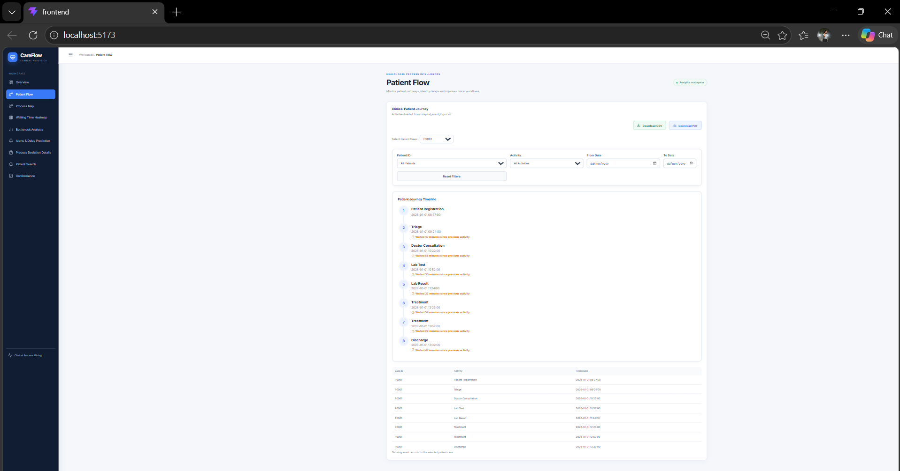
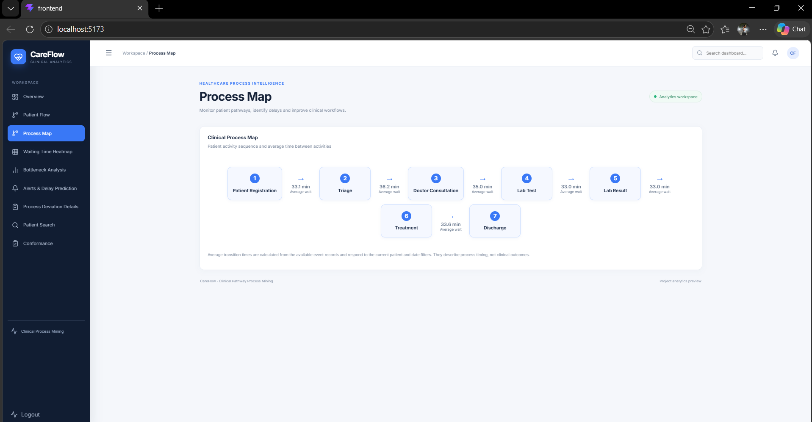
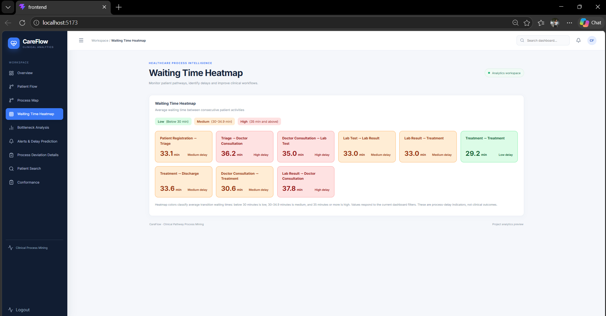
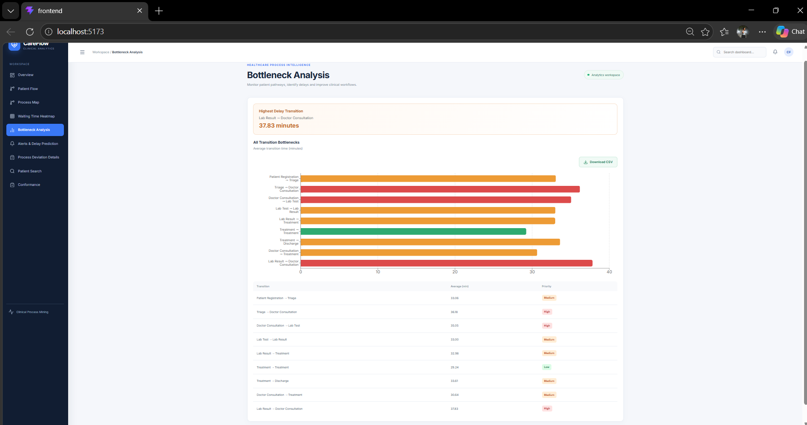
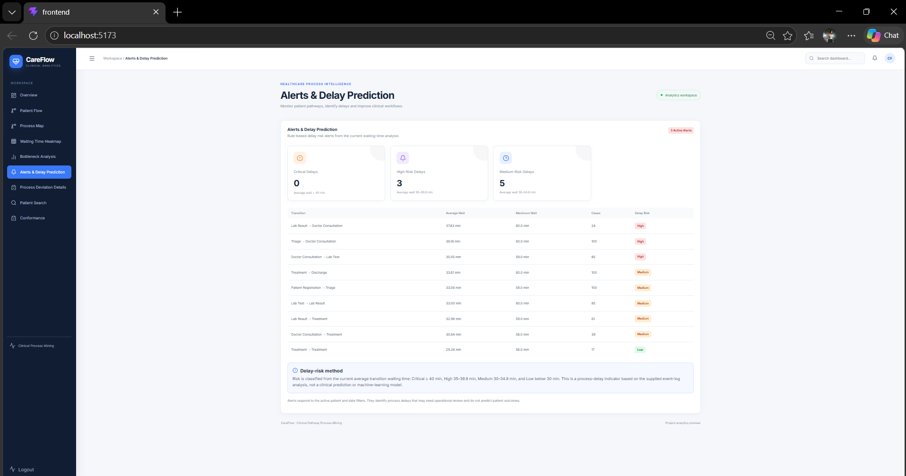
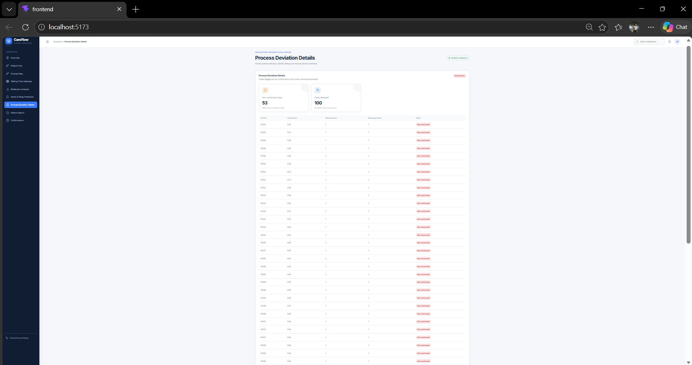
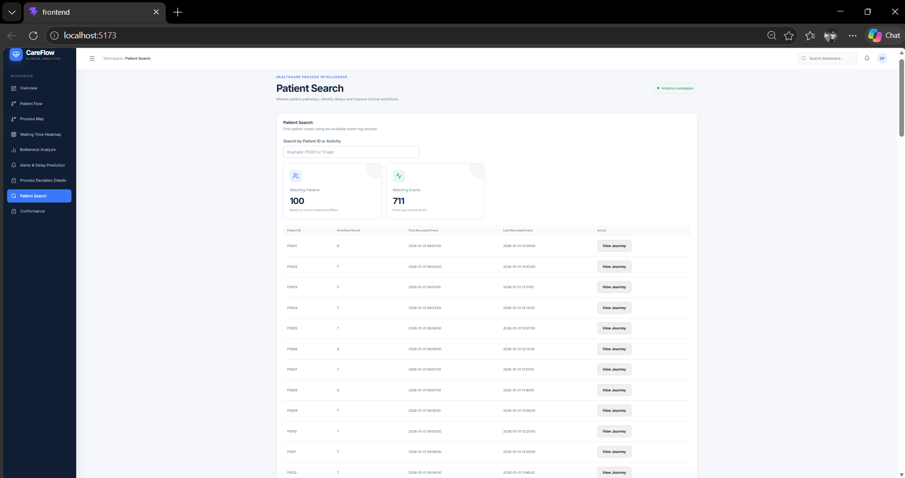
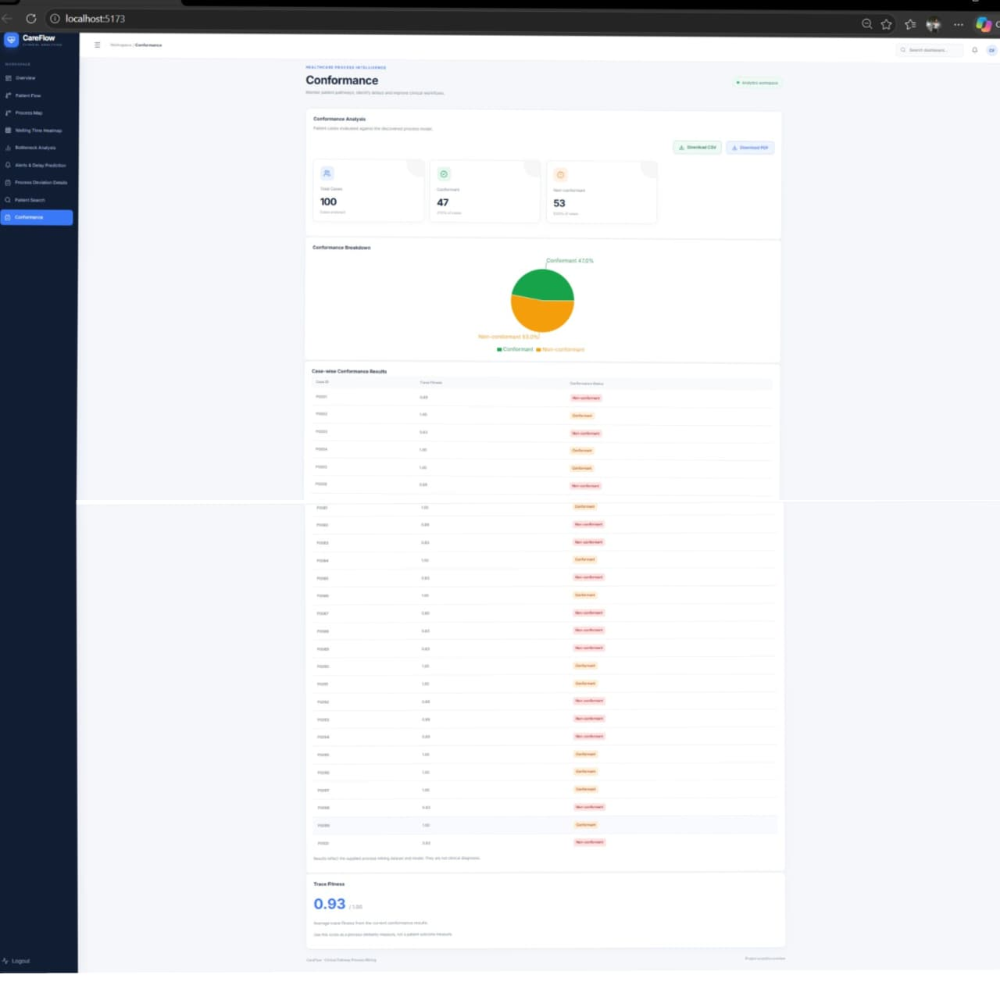

# CareFlow
### Infotact Group Project

**Healthcare Process Intelligence – Clinical Pathway Process Mining**

## 📌 About the Project

CareFlow is a healthcare process intelligence project designed to analyze hospital workflows using process mining techniques. It helps identify bottlenecks, monitor patient pathways, evaluate process conformance, analyze waiting times, detect process deviations, and identify potential delay risks.

The project provides an interactive web-based analytics dashboard that transforms hospital event log data into meaningful visual insights for understanding clinical workflow performance.

## 🎯 Project Objectives

- Analyze patient journeys through different hospital activities.
- Identify bottlenecks and delays in clinical workflows.
- Analyze waiting times between consecutive activities.
- Monitor individual patient pathways.
- Evaluate process conformance against the expected process.
- Detect process deviations in patient journeys.
- Provide rule-based delay risk indicators.
- Visualize healthcare process insights through an interactive dashboard.

## ✨ Key Features

- **Patient Flow Analysis:** Track patient activities and waiting times between consecutive activities.
- **Process Map:** Visualize the overall clinical workflow and activity transitions.
- **Waiting Time Heatmap:** Identify activities and transitions with higher waiting times.
- **Bottleneck Analysis:** Identify time-consuming transitions in hospital workflows.
- **Alerts & Delay Prediction:** Classify potential delay risks as Critical, High, Medium, or Low based on waiting time.
- **Process Deviation Details:** Identify patient cases that deviate from the expected process.
- **Patient Search:** Search and analyze individual patient event records.
- **Conformance Analysis:** Evaluate whether patient pathways follow the expected process model.
- **Admin Login & Logout:** Provides basic dashboard access control.
- **Interactive Dashboard:** Presents healthcare process metrics and analysis results in an easy-to-understand interface.

## 📊 Dashboard Modules

1. **Overview** – Displays total patients, conformance rate, average trace fitness, and high-priority bottleneck count.
2. **Patient Flow** – Displays patient activity timelines and waiting times between activities.
3. **Process Map** – Displays the overall clinical process flow and activity transitions.
4. **Waiting Time Heatmap** – Visualizes waiting-time patterns across the clinical workflow.
5. **Bottleneck Analysis** – Identifies process transitions with high, medium, and low priority delays.
6. **Alerts & Delay Prediction** – Provides rule-based delay risk classification based on waiting time.
7. **Process Deviation Details** – Displays process deviations identified from patient event traces.
8. **Patient Search** – Allows users to search and inspect patient-specific event records.
9. **Conformance** – Displays conformant and non-conformant cases with trace fitness information.

## 🔄 Hospital Workflow

The analyzed hospital workflow includes the following activities:

1. Patient Registration
2. Triage
3. Doctor Consultation
4. Lab Test
5. Lab Result
6. Treatment
7. Discharge

The patient journey is analyzed using the timestamps recorded for each activity.

## 🛠️ Technologies Used

### Frontend

- React.js
- Vite
- JavaScript
- CSS

### Data Analysis & Process Mining

- Python
- Pandas
- PM4Py

### Data Visualization

- Recharts
- PapaParse
- Lucide React

### Data Platform

- Google BigQuery
- dbt

### Version Control

- Git
- GitHub

## 📁 Project Structure

```text
CareFlow/
│
├── frontend/
│   ├── public/
│   │   ├── hospital_event_logs.csv
│   │   ├── bottleneck_analysis.csv
│   │   └── conformance_results.csv
│   │
│   ├── src/
│   │   ├── App.jsx
│   │   ├── App.css
│   │   └── ...
│   │
│   └── package.json
│
├── screenshots/
│   ├── login.png
│   ├── overview.png
│   ├── patient-flow.png
│   ├── process-map.png
│   ├── waiting-time-heatmap.png
│   ├── bottleneck-analysis.png
│   ├── alerts-delay-prediction.png
│   ├── process-deviation.png
│   ├── patient-search.png
│   └── conformance.jpeg
│
├── bottleneck_analysis.py
├── process_mining.py
└── README.md
```

## ⚙️ Installation and Setup

### Prerequisites

- Node.js and npm
- Python 3
- Git

### Step 1: Clone the Repository

```bash
git clone https://github.com/sahajeya/CareFlow.git
```

### Step 2: Navigate to the Frontend

```bash
cd CareFlow/frontend
```

### Step 3: Install Dependencies

```bash
npm install
```

### Step 4: Run the Application

```bash
npm run dev
```

### Step 5: Open in Browser

Open the local URL displayed in the terminal, usually:

```text
http://localhost:5173/
```

## 📸 Dashboard Screenshots

### Login Page



### Overview Dashboard



### Patient Flow



### Process Map



### Waiting Time Heatmap



### Bottleneck Analysis



### Alerts & Delay Prediction



### Process Deviation Details



### Patient Search



### Conformance Analysis



## 📈 Dataset and Analysis

The project uses hospital event log data containing patient case IDs, activity names, and timestamps.

The current dataset contains:

- **100 patient cases**
- **700 hospital activity events**
- **7 clinical activities per patient**
- Patient cases from **P0001 to P0100**

The event sequence follows:

**Patient Registration → Triage → Doctor Consultation → Lab Test → Lab Result → Treatment → Discharge**

The analysis includes:

- Patient journey analysis
- Waiting-time analysis
- Bottleneck transition analysis
- Process map generation
- Process deviation analysis
- Process conformance evaluation
- Trace fitness measurement
- Rule-based delay risk classification

The displayed results reflect the supplied process-mining dataset and model. They are intended for workflow analysis and are not clinical diagnoses.

## 🔬 Process Mining

CareFlow uses process mining techniques to analyze the actual sequence of patient activities.

The event log is used to understand:

- How patients move through the workflow.
- How long patients wait between activities.
- Which transitions create bottlenecks.
- Whether patient traces follow the expected process.
- Where process deviations occur.

PM4Py is used for process mining and conformance analysis.

## 🚦 Delay Risk Classification

CareFlow provides a rule-based delay risk indicator using average waiting time.

| Waiting Time | Risk Level |
|---|---|
| Less than 30 minutes | Low |
| 30 – 34.9 minutes | Medium |
| 35 – 39.9 minutes | High |
| 40 minutes or more | Critical |

This feature is a **rule-based delay risk indicator**, not a machine learning prediction model.

## 📊 Results

The dashboard provides an interactive view of clinical process performance.

The project successfully demonstrates:

- Identification of high waiting-time transitions.
- Visualization of patient pathways.
- Identification of process bottlenecks.
- Detection of process deviations.
- Conformance analysis of patient traces.
- Patient-specific event search.
- Visual representation of clinical workflows.
- Rule-based identification of potential delay risks.

## 👥 Project Details

**Project Name:** CareFlow  
**Organization:** Infotact  
**Project Type:** Group Project  
**Domain:** Healthcare Analytics and Process Mining  
**Team Size:** 4

## 🚀 Future Enhancements

- Integration with real-time hospital data.
- Machine learning-based delay prediction.
- Real-time hospital workflow monitoring.
- Department-wise analysis when department information is available.
- Automated alerts for hospital staff.
- Advanced predictive analytics.
- Integration with hospital information systems.
- More detailed patient journey visualizations.
- Enhanced reporting and analytics.

## 📌 Conclusion

CareFlow provides an interactive approach to understanding hospital workflows through process mining and clinical analytics.

By analyzing patient journeys, waiting times, bottlenecks, process deviations, and conformance, the project provides meaningful insights into healthcare process performance.

The dashboard makes complex process-mining results easier to understand and supports the identification of areas where workflow efficiency can potentially be improved.

**CareFlow – Healthcare Process Intelligence**